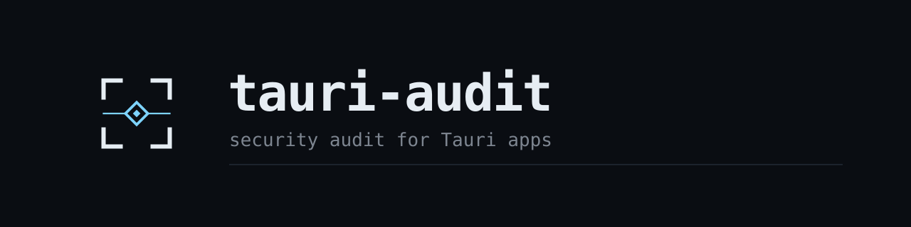

<p align="center">
  
</p>

<p align="center"><b>Your Tauri app trusts more than you think.</b><br>This finds out how much, and shows how an attacker would use it.</p>

---

Most security scanners hand you a list. A list of 20 findings doesn't tell you which three can actually hurt you.

`tauri-audit` reads your Tauri config, capabilities, CSP, updater, Cargo features and Rust commands, then does two things a list can't:

1. **Chains findings into attack paths.** A weak CSP is a medium. A shell permission is a medium. Together they are "one XSS bug becomes code execution", and you get that sentence, plus the cheapest link to cut.
2. **Gives Claude the judgment step.** The checker is deterministic and finds problems. The skill makes Claude decide which ones are reachable in *your* app and propose the smallest fix that won't break it.

```text
tauri-audit 0.2.0  my-app
project: src-tauri/tauri.conf.json (Tauri v2)
grade: F (0/100)

ATTACK PATHS (2)
  ! A remote site you trust can take over the machine
    chain: CAP-FS-BROAD + CAP-REMOTE-IPC + CAP-SHELL-SCOPE
    break it: Remove `remote.urls` from the capability. It is the cheapest link to cut.

  ! One XSS bug becomes code execution or file write
    chain: CAP-SHELL-SCOPE + CSP-UNSAFE-EVAL + CSP-WILDCARD-SOURCE
    break it: Tighten the CSP first, then narrow the permission scopes.

CRITICAL  CAP-SHELL-SCOPE  Shell command scope is unsafe
    src-tauri/capabilities/default.json  ->  permissions[3].allow[0]
    fix: Expose a fixed binary or a Rust command; never an interpreter.
```

That output comes from the intentionally broken fixture in `tests/fixtures/insecure`. The clean fixture scores `A (100/100)`, and the tests keep it that way.

## Install in Claude

### Claude Code

```text
/plugin marketplace add Wooinxlkz/Tauri-audit-plugin
/plugin install tauri-audit@tauri-audit
```

Then run `/tauri-audit` inside a Tauri project, or just say "audit my Tauri app". To try it from a local clone without publishing, start Claude Code with `claude --plugin-dir ./Tauri-audit-plugin`.

### Claude Cowork and Claude.ai

Upload `tauri-audit.skill` in the Skills settings (the `skills/tauri-audit` folder zipped works too). Then attach or paste your `tauri.conf.json` and `capabilities/*.json` and ask for an audit. In chat there is no project folder, so Claude writes your files to a temp folder and runs the same checker on them.

### No Claude at all

```bash
python3 skills/tauri-audit/scripts/tauri_audit.py path/to/your/app
```

Python 3.8+, no packages. TOML capability files need 3.11+.

## What it looks at

| Area | Catches |
| --- | --- |
| CSP | missing policy, `'unsafe-eval'`, `'unsafe-inline'`, `*`, bare `https:` / `data:`, public script CDNs, plaintext sources, disabled asset hardening |
| App config | `withGlobalTauri`, `freezePrototype`, asset protocol scope, remote window URLs, placeholder identifier, macOS private API |
| Updater | no `pubkey`, plaintext endpoints, `dangerousInsecureTransportProtocol` |
| Capabilities | remote origins with IPC access, `"*"` windows, `$HOME/**` style scopes, shell interpreters and `args: true`, wide `http` / `opener` scopes, missing or orphaned capabilities |
| Least privilege | permissions for plugins your frontend never imports |
| Rust and Cargo | `devtools` in release, commands not locked by an app manifest, commands taking raw path / URL / command strings |
| Tauri v1 | `allowlist.all`, module-wide enables, broad scopes, remote domain IPC |

42 rules, each with a stable ID. Why each matters and the safest fix: [`references/rules.md`](skills/tauri-audit/references/rules.md).

### The five attack paths

| Path | Combines |
| --- | --- |
| Remote site takes over the machine | remote IPC + file write / shell / open permissions |
| One XSS becomes code execution | weak CSP + file write / shell / open permissions |
| Update channel ships code to every install | unsigned or plaintext updates |
| Injected script reaches IPC with no imports | weak CSP + `withGlobalTauri` |
| Scripts read local files and send them anywhere | asset protocol + weak CSP or wide HTTP scope |

## Using the CLI

```text
tauri_audit.py [PATH] [--format text|json|markdown|sarif|html] [--fail-on LEVEL]
               [--ignore RULE_ID] [--no-frontend-scan] [--no-color] [-o FILE]
               [--badge FILE.svg] [--baseline FILE | --write-baseline FILE]
               [--list-rules]
```

`PATH` can be a repo root (monorepos work), one `tauri.conf.json`, or a single capability file. It never writes to your project. Exit codes: `0` below the `--fail-on` level (default `high`), `1` at or above it, `2` bad input.

**Grade and badge.** Score is 100 minus 25 per critical, 10 per high, 4 per medium, 1 per low. A is 90+, B 75+, C 60+, D 40+, F below.

```bash
python3 tauri_audit.py . --badge assets/tauri-audit-badge.svg
```

**HTML report** you can send to someone: `--format html -o report.html`. Self-contained, escaped, follows light or dark mode.

**Baselines**, for adopting it on an existing app without a wall of red:

```bash
python3 tauri_audit.py . --write-baseline .tauri-audit-baseline.json   # accept today's state
python3 tauri_audit.py . --baseline .tauri-audit-baseline.json         # CI: fail only on NEW findings
```

**Silence a rule** for a project with a `.tauri-audit.json` at the audited root:

```json
{ "ignore": ["CAP-UNUSED-PLUGIN"] }
```

### GitHub code scanning

```yaml
- run: python3 path/to/tauri_audit.py . --format sarif --fail-on never -o tauri-audit.sarif
- uses: github/codeql-action/upload-sarif@v3
  with:
    sarif_file: tauri-audit.sarif
```

Swap `--fail-on never` for `--fail-on high` to block merges.

## How it avoids breaking your app

The checker is read-only. The skill proposes a diff before touching anything, narrows a scope instead of deleting a permission you use, keeps `ipc:` and `http://ipc.localhost` in your CSP, checks the frontend and Rust for real usage before removing a permission, re-runs the checker after every change, and tells you which `tauri dev` flows to click through. Claude can't run your GUI, so that last check is yours.

## Honest limits

- Static analysis of text. It does not run your app. A clean result is not proof of safety.
- Findings point to a file and JSON pointer, not a line number.
- Windows created at runtime, plugins used only from Rust, and the logic inside your commands need a human. Those are flagged as hints, never verdicts.
- Rules follow the Tauri v2 docs and may lag new plugin permissions. Report misses and false positives as issues.

## Layout

```text
.claude-plugin/        plugin + marketplace manifests
commands/              /tauri-audit
skills/tauri-audit/    SKILL.md, scripts/tauri_audit.py, references/rules.md
tests/                 unit tests + insecure/secure fixtures
assets/                logo and banner
```

## Develop

```bash
python3 -m unittest discover -s tests -v
```

See [CONTRIBUTING.md](CONTRIBUTING.md). Security reports: [SECURITY.md](SECURITY.md). History: [CHANGELOG.md](CHANGELOG.md).

Next up: the same treatment for other frameworks (Next.js headers, Docker Compose) as modules inside this plugin.

## License

MIT, see [LICENSE](LICENSE). Built by [Karim (Wooinxlkz)](https://github.com/Wooinxlkz).
